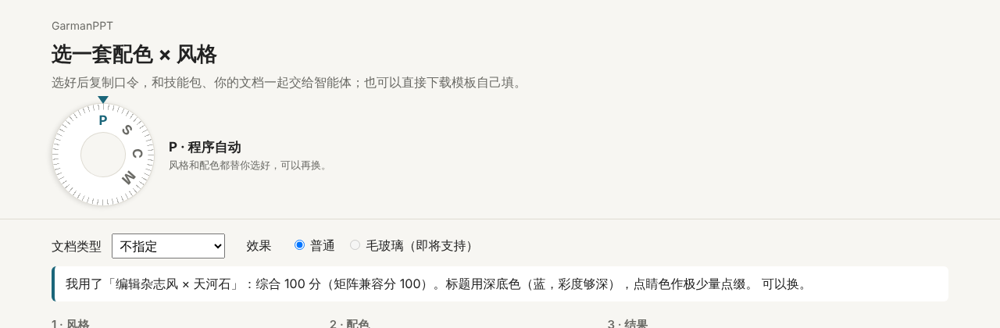

# garman-ppt-site

GarmanPPT「配色 × 风格」组合挑选网站。纯静态页面，没有后端，不在线生成 PPT。

- 在线预览：https://99243537-sketch.github.io/garman-ppt-site/
- 正式站点：https://www.zhaodun.work/ppt/pick/（由 Eddy 部署，见 [DEPLOY.md](DEPLOY.md)）
- 技能本体：[99243537-sketch/garman-ppt](https://github.com/99243537-sketch/garman-ppt)



## 和 garman-ppt 的关系

| 仓库 | 层面 | 给谁用 | 发布物 |
|---|---|---|---|
| garman-ppt | 技能（智能体「做」PPT） | 智能体、技能用户 | `garman-ppt-<版本>.zip`，标签 `v0.3.x` |
| **garman-ppt-site**（本仓库） | 网站（人「看和选」组合） | 网站访客、部署者 | `garman-site-<版本>.zip`，标签 `site-v0.x.y` |

两边版本号互不牵连：网站改个按钮不用给技能发版。网站给出的口令（如「配色：银杏；风格：新粗野主义」）交给装了技能的智能体使用。

## 挑选页怎么选

页面顶部是仿相机的模式转盘：

| 挡位 | 意思 |
|---|---|
| **S** 风格优先（默认） | 先选一种风格，再看哪套配色最合适：配色按合适程度排好，自动选第一名 |
| **C** 色彩优先 | 先选一套配色，再看哪种风格最合适 |
| **P** 程序自动 | 风格和配色都替你选好，可以再换 |
| **M** 手动 | 按原顺序列出，不排序、不推荐 |

P / S / C 挡给每个组合标「推荐 / 中性 / 反对」：综合分 = 兼容矩阵分 + 文档类型加分 + 效果冲突扣分，按排名切成 1/4、1/2、1/4；矩阵判为冲突的一律反对。规则都在 `site/ppt/site-data/rules.json`，页面不写死。

选好后有两条路：**下载模板**（16 种风格 × 13 套配色，208 个组合全有 .pptx 和 6 页预览图，大胆风格会提饱和或加签名色；与毛玻璃兼容的 5 种风格另有毛玻璃版），或者**用 AI 做成品**：一键下载组合包（母版 + 6 页预览图 + 写好的提示词，服务器放了技能 zip 时连技能一起），解压后交给自己的智能体；16 种风格都能用，打包在浏览器里完成，不需要后端。

## 目录

```
site/                     GitHub Pages 发布这一层
├─ index.html             跳转到 ppt/pick/
└─ ppt/                   = 服务器上的 /ppt/
   ├─ pick/               挑选页（index.html、pick.css、pick.js、pack.js）
   ├─ site-data/          配色、风格、兼容矩阵、规则、版本（脚本生成，勿手改）
   ├─ templates/          260 份「下载这套主题」.pptx（含 52 份毛玻璃版）
   └─ previews/           260 张 6 页预览图
tools/
├─ build_site_data.py     从源数据生成 site-data
├─ export-styles.cjs      把风格库 data.js 导出成 JSON
├─ sources/               当前使用的源数据（兼容矩阵、风格库导出）
└─ masters/               模板生成脚本（16 个风格类 + build_all.py 批量换色 + render_previews.py 出预览图 + glassify.py 出毛玻璃版）
docs/preview/             截图
DEPLOY.md                 部署说明（给 Eddy）
```

## 更新流程

1. 改源数据或规则后重新生成：`python3 tools/build_site_data.py tools/sources/matrix-data.json tools/sources/styles-v2.json site/ppt/site-data`
2. 本地预览：在 `site/` 下运行 `python3 -m http.server`，打开 `http://localhost:8000/ppt/pick/`
3. 推到 main：GitHub Pages 自动更新预览
4. 发版：`version.json` 改好版本号后打标签 `site-v<版本>`，Release 自动附上 `garman-site-<版本>.zip`，Eddy 从这里拉取

模板重新生成：把 `tools/masters/` 下的脚本放在一起运行 `python3 build_masters.py <目录>`（母版 v1 三套）和 `python3 build_masters_batch2.py <目录>`（第二批四套）定稿，再用 `python3 build_all.py site/ppt/site-data <目录> [风格id…]` 生成其余 201 份（第三批 9 种风格的版式在 `build_masters_batch3.py`）；预览图用 `python3 render_previews.py <目录> <pptx…>`（LibreOffice 转 PDF 后拼成 6 页图），依赖 python-pptx 1.0.x、lxml、Pillow。发布前用 `check_text.py <词表> <文件…>` 做敏感词自检（词表不放在公开仓库里）。

## 来源与署名

风格库的栏目结构参考了观默 @guanmo_ai 的《每天一个设计风格》，文字与色值均为重写。Garman 自然色、兼容矩阵与模板由赵盾 AI 学习工作室制作，AI 辅助生成，经人工审核。许可证待定。
